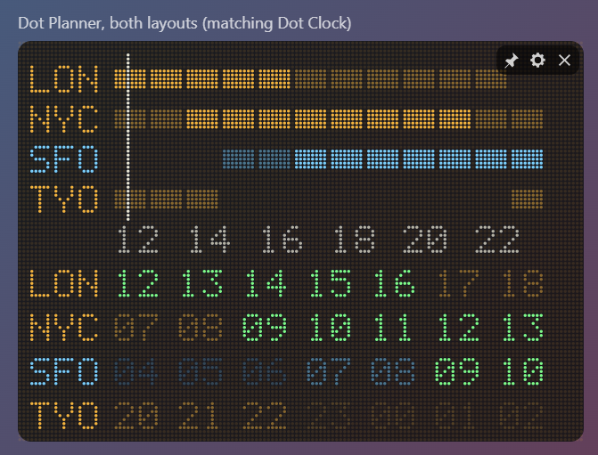
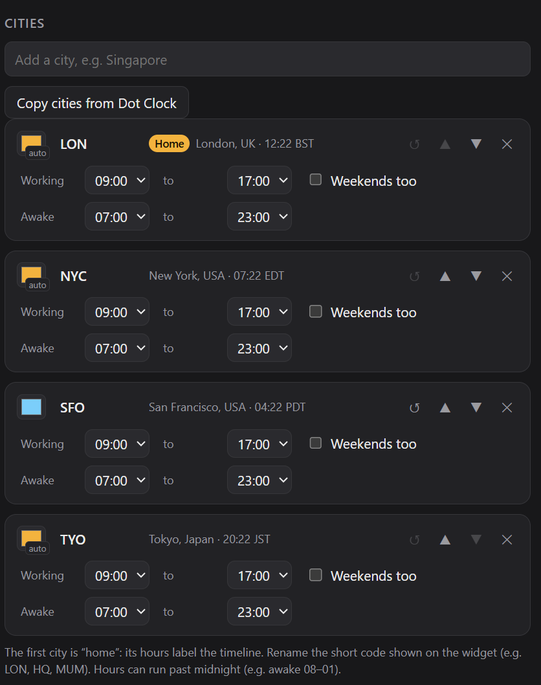

# Dot Planner

A meeting-friendly world planner for Windows and macOS, in dot-matrix style. It shows the next few hours across your cities, with each city's working hours lit, so you can see at a glance when everyone is around..

## What it does

**Two layouts.** Tick either or both, in any order:

- **Hour blocks.** One row per city, with a block for each coming hour.
  - **Bright** blocks are working hours, **dim** blocks are awake, and **dark** means asleep.
  - A bar on top lights up wherever **everyone is working**.
  - A line marks **now**, and the home city's hours run along the bottom.
- **Local hours.** Each city's own clock hour for the coming hours. **Highlighted** is working, **dim** is awake and **faint** is asleep. Read down a column to see what time it is everywhere for that slot.

**Your cities.** Add up to 10 by searching the built-in list of about 600 cities, or copy them from Dot Clock. On first run it starts with Dot Clock's cities automatically. Each city has:
- an editable short code on the widget, e.g. `LON`, `HQ` or `MUM`
- its own colour
- working hours and awake hours. These can run past midnight, e.g. awake 08:00–01:00.
- **Weekends too**, for people who work weekends

**Settings also include:**
- **Next meeting window:** the next time everyone is working, shown in every city's time. If there isn't one, it shows the best partial overlap, e.g. "3 of 4 working".
- **Look ahead:** 6, 12 or 24 hours.
- **Hours shown as:** 24-hour, or 12-hour (`2P`).
- **Highlight colour.**
- **Chime:** an optional chime when a window with everyone working begins.

**Fits with Dot Clock.** Same width, dot size and colours.

## How it works

- **Time zones** come from your computer's own time-zone database, so daylight-saving changes and half-hour zones like India and Newfoundland are handled.
- **The home city** is the first in the list. Its hours label the timeline.
- **Offline.** It never connects to the internet.

## Building it yourself

See [BUILDING.md](BUILDING.md)..

## Check out the Singular Widgets

[Dot Calendar](https://github.com/slainbya-dotcom/dot-Calendar)
[Dot Clipboard](https://github.com/slainbya-dotcom/dot-clipboard)
[Dot Clock](https://github.com/slainbya-dotcom/dot-clock)
[Dot Deck](https://github.com/slainbya-dotcom/dot-deck)
[Dot Dice](https://github.com/slainbya-dotcom/dot-dice)
[Dot Focus](https://github.com/slainbya-dotcom/dot-focus)
[Dot Launcher](https://github.com/slainbya-dotcom/dot-launcher)
[Dot List](https://github.com/slainbya-dotcom/dot-list)
[Dot Planner](https://github.com/slainbya-dotcom/dot-planner)
[Dot Player](https://github.com/slainbya-dotcom/dot-player)
[Dot Reader](https://github.com/slainbya-dotcom/dot-reader)
[Dot Sun](https://github.com/slainbya-dotcom/dot-sun)
[Dot System](https://github.com/slainbya-dotcom/dot-system)
[Dot Ticker](https://github.com/slainbya-dotcom/dot-ticker)
[Dot Timer](https://github.com/slainbya-dotcom/dot-timer)
[Dot Visualiser](https://github.com/slainbya-dotcom/dot-visualiser)
[Dot Weather](https://github.com/slainbya-dotcom/dot-weather)